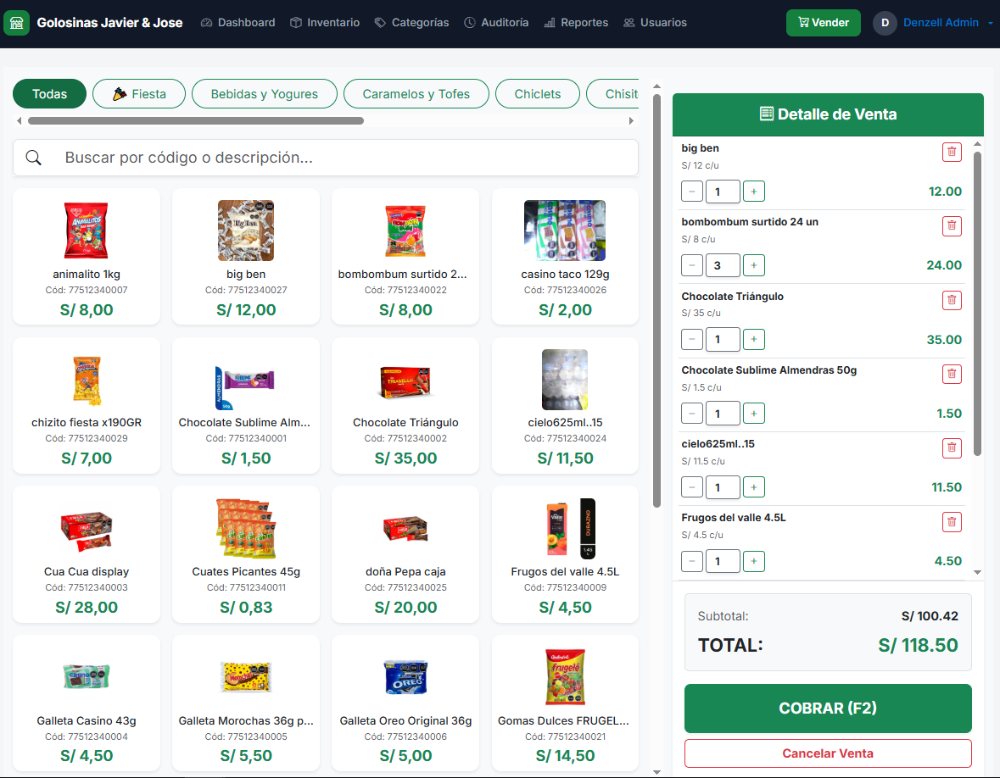
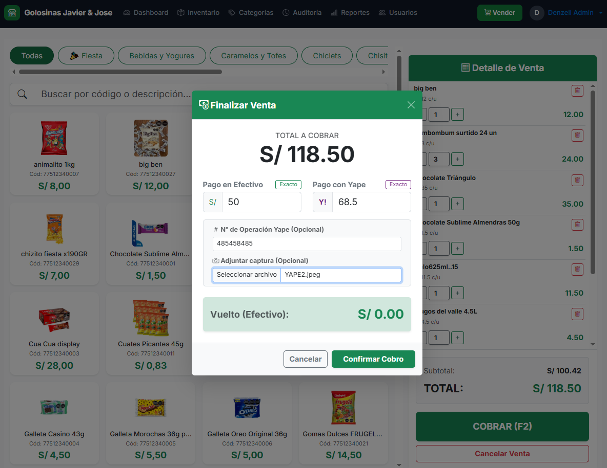
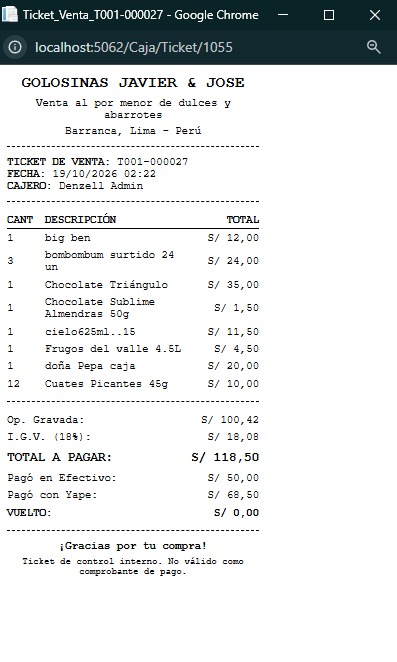
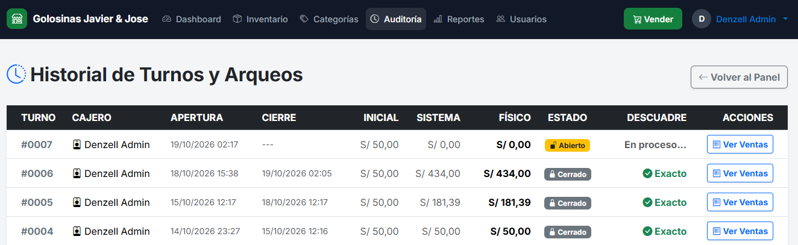
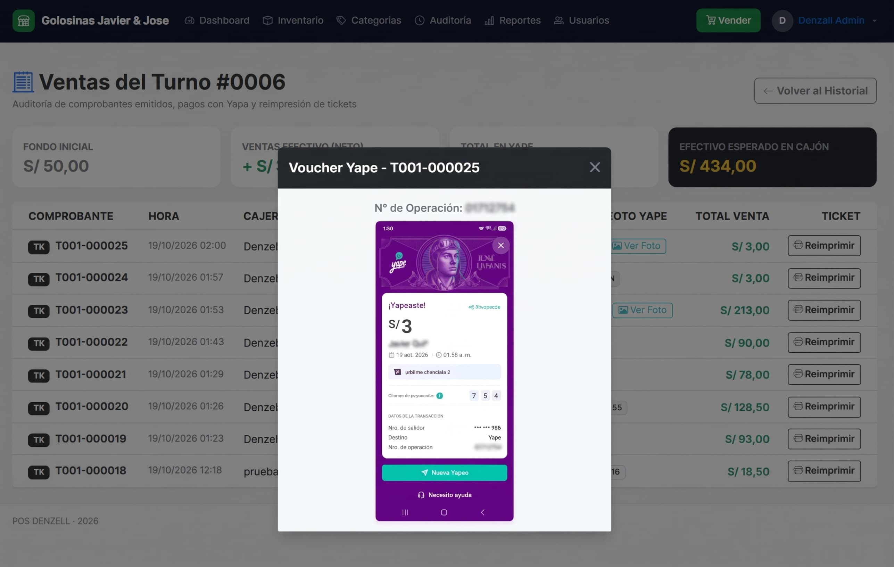
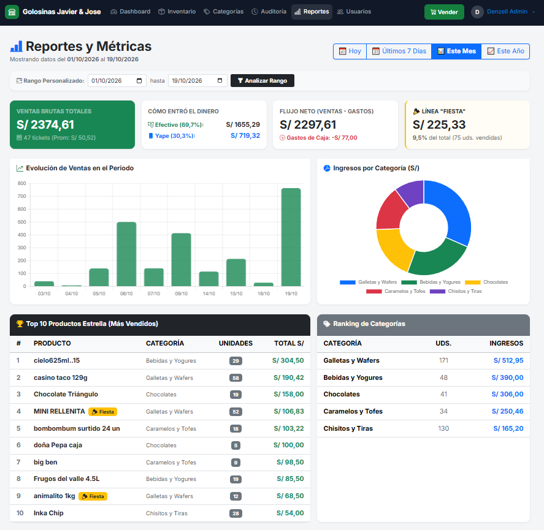

# 🛒 POS_DENZELL — Sistema POS, Control de Caja y Business Intelligence


> **Propósito:** aplicación web *full-stack* para digitalizar la operación de un comercio minorista y mayorista de confitería y abarrotes. Agiliza el cobro en mostrador, cuadra la caja al céntimo, deja evidencia de los pagos por **Yape** y convierte las ventas en reportes útiles para decidir qué comprar y cuándo.

---

## 📌 Resumen

| Dimensión | Detalle |
| :--- | :--- |
| **🎯 Problema** | Cobros manuales lentos, descuadres entre el efectivo de la gaveta y los ingresos por Yape, y poca visibilidad de qué productos y horarios generan más ventas. |
| **💡 Solución** | POS con **cobro mixto (Efectivo + Yape)**, arqueo de caja por turno y paneles de **Business Intelligence**. |
| **👨‍💻 Rol** | Diseño y desarrollo *end-to-end* en solitario: backend, modelo de datos y frontend. Primer proyecto full-stack con .NET. |
| **🔍 Enfoque técnico** | Integridad transaccional, precisión contable, trazabilidad de pagos digitales y separación en capas. |
| **🚀 Estado** | ✅ Funcional de punta a punta y listo para su primer despliegue. Piloto programado en un negocio real. |

---

## 🖼️ Capturas

> *Todas las capturas usan datos de prueba.*

| 🛒 Punto de Venta | 💳 Cobro Mixto | 🧾 Ticket Térmico |
| :---: | :---: | :---: |
|  |  |  |
| *Catálogo con búsqueda instantánea y carrito* | *Efectivo + Yape con cálculo de vuelto* | *Ticket de 80mm, marcado como control interno* |

| 🔐 Arqueo de Caja | 📱 Evidencia Yape | 📊 Business Intelligence |
| :---: | :---: | :---: |
|  |  |  |
| *Cierre de turno con descuadre calculado* | *Visor de comprobante (datos sensibles difuminados)* | *KPIs, gráficos y ranking de productos* |

---

## 🏗️ Decisiones Técnicas

Cada decisión responde a un problema concreto de la operación de caja:

* **🔸 Reto: mantener el código ordenado y fácil de probar.**
  ➔ **Arquitectura en capas basada en servicios.** Los controladores solo manejan HTTP y seguridad. La lógica de negocio vive en servicios inyectados por interfaz (`IVentaService`, `ICajaService`, `IProductoService`, `ICategoriaService`, `IReporteService`, `IUsuarioService`, `IAuthService`). Ningún controlador accede directamente a `DbContext`.

* **🔸 Reto: evitar diferencias de céntimos entre el carrito (JS), la base de datos y el ticket impreso.**
  ➔ **Redondeo comercial unificado.**
  * Precios unitarios en `decimal(10,3)` para ventas fraccionadas o por docena (ej. `S/ 23.00 / 12 = S/ 1.917`).
  * Subtotales y arqueos en `decimal(10,2)`, con redondeo por fila (`MidpointRounding.AwayFromZero` en C# y corrección con `Number.EPSILON` en JavaScript) **antes** de totalizar.
  * IGV (18%) calculado por diferencia sobre la base imponible.

* **🔸 Reto: que ninguna venta quede a medias ante un error del servidor.**
  ➔ **Transacción atómica (`BeginTransactionAsync`).** El correlativo, la cabecera (`Venta`), el detalle (`VentaDetalle`) y el descuento de stock se confirman juntos. Si algo falla, se ejecuta `RollbackAsync()` y se elimina el archivo del comprobante Yape que ya se hubiera subido al servidor.

* **🔸 Reto: cuadrar la gaveta sin que los pagos digitales distorsionen el efectivo.**
  ➔ **Fórmula de arqueo separada por medio de pago.** El efectivo esperado es `Fondo Inicial + Efectivo Neto de Ventas − Gastos Menores`; los ingresos por Yape se llevan aparte. Así se detectan sobrantes o faltantes reales al cerrar cada turno.

* **🔸 Reto: conservar el historial para reportes y cierres pasados.**
  ➔ **Borrado lógico (*soft delete*).** No se hace `DELETE` físico en `Productos`, `Categorias` ni `Usuarios`; se usa `Activo = false`, así las ventas antiguas siguen apuntando a datos válidos.

* **🔸 Reto: evitar errores de coma/punto decimal entre PC (Windows) y tablets (Android/iOS).**
  ➔ **`InvariantCulture`.** Normalización de decimales entre vistas Razor, JavaScript y C#, independiente de la configuración regional del dispositivo.

---

## 🚀 Módulos

### 🛒 1. Punto de Venta
* **Búsqueda instantánea:** filtrado en el navegador (sin consultas al servidor) por descripción, código de barras, categoría y etiqueta de campaña (**🎉 Fiesta**).
* **Cobro mixto (Efectivo + Yape):** cálculo automático de vuelto y botones de monto exacto.
* **Evidencia de pagos Yape:** registro del número de operación y foto del comprobante, con validación de formato y nombre auditable (`YAPE_yyyyMMddHHmmss_Operacion.jpg`).
* **Impresión térmica:** ticket para impresoras de **80mm y 58mm** con reglas `@media print`.

### 🔐 2. Turnos, Arqueo y Auditoría
* **Ciclo del turno:** apertura con fondo inicial, registro de egresos menores de gaveta y cierre con cálculo automático del descuadre.
* **Detalle por turno (`DetalleTurno`):** tickets emitidos, visor de capturas Yape y **reimpresión en 1 clic**.

### 📊 3. Business Intelligence
* **Dashboard operativo (`Home/Index`):** turno en vivo, comparativa Efectivo vs. Yape, cantidad de tickets y alerta de **stock crítico (`Stock <= 5`)**.
* **Dashboard ejecutivo (`Reporte/Index`):** filtros por fecha, **flujo neto** (`Ventas Brutas − Gastos de Caja`), ticket promedio, participación por medio de pago, rendimiento de la línea **🎉 Fiesta** y **Top 10 de productos** con **Chart.js**.

### 🛡️ 4. Seguridad por Roles (RBAC)
* **Sesión:** cookies encriptadas con expiración de **8 horas** (una jornada laboral).
* **Administrador:** BI ejecutivo, auditoría histórica, catálogo, inventario y usuarios (con protección **anti-autobloqueo** de la cuenta propia).
* **Cajero:** solo POS, su turno activo y reimpresión. Las rutas administrativas se bloquean en la interfaz y en el servidor con `[Authorize(Roles = "Administrador")]`.

---

## ⚠️ Alcance Actual

* ✅ **Completado:** venta minorista y mayorista, cobro mixto con evidencia Yape, arqueo de caja, inventario, BI operativo y ejecutivo, seguridad por roles y reimpresión térmica.
* ⚠️ **Tickets internos:** el sistema emite tickets con serie y correlativo propios (`T001-000001`) y desglose de Operaciones Gravadas e IGV (18%). **No son comprobantes electrónicos válidos ante SUNAT.**
* 🔜 **Facturación electrónica:** el modelo de datos y el cálculo de IGV están preparados para integrar un OSE/PSE en la siguiente iteración. La integración aún no está implementada.

### 🧭 Roadmap
- [ ] **Pruebas unitarias (xUnit)** sobre servicios críticos: IGV, redondeo y fórmula de arqueo.
- [ ] **Control de concurrencia** en el descuento de stock y la generación de correlativos para varias cajas simultáneas.
- [ ] **Integración con OSE/PSE** para boletas y facturas electrónicas.
- [ ] **CI/CD y respaldos:** pipeline en GitHub Actions (build + tests) y respaldo automático de SQL Server.

---

## ▶️ Cómo ejecutarlo

**Requisitos:** .NET 10 SDK, SQL Server (o SQL Server Express) y la herramienta `dotnet-ef`.

```bash
git clone <URL-DEL-REPOSITORIO>
cd POS_DENZELL

# 1. Revisa la cadena de conexión en appsettings.json (por defecto usa el SQL Server local)
#    "DefaultConnection": "Server=.;Database=DB_POS_DENZELL;Trusted_Connection=True;MultipleActiveResultSets=true;TrustServerCertificate=True"

# 2. Crea la base de datos con las migraciones
dotnet ef database update

# 3. Ejecuta la aplicación
dotnet run
```

<!-- TODO: indica el usuario de prueba o cómo se crea el primer administrador (sin datos reales) -->
**Usuario de prueba (solo desarrollo):** `admin` / `********`

---

## 🛠️ Stack y Estructura

| Capa | Tecnologías |
| :--- | :--- |
| **Backend** | C#, ASP.NET Core MVC (.NET 10), inyección de dependencias |
| **Datos** | SQL Server, Entity Framework Core (Code-First, Migrations, LINQ, transacciones explícitas) |
| **Frontend** | Razor Views, Bootstrap 5, Bootstrap Icons, JavaScript ES6 modular |
| **Visualización** | Chart.js |

```text
POS_DENZELL/
├── Controllers/   # Flujo HTTP, rutas y autorización [Authorize]
├── Services/      # Reglas de negocio, cálculos financieros, transacciones y consultas EF Core
├── Models/        # Entidades (Venta, VentaDetalle, TurnoCaja, Producto, etc.)
├── DTOs/          # DashboardBiDTO, ResumenCajaDTO, TicketVentaDTO
├── Data/          # ApplicationDbContext, Fluent API y precisión decimal en SQL
├── Views/         # Vistas Razor modulares e interfaz de impresión térmica
└── wwwroot/       # Scripts JS, estilos y almacenamiento de evidencias Yape
```

---

## 👤 Autor

**Denzell Washington Jose Quito** · Estudiante de 7.º ciclo de Ingeniería de Sistemas · www.linkedin.com/in/denzell-quito-gilio · denzellcrac@gmail.com
